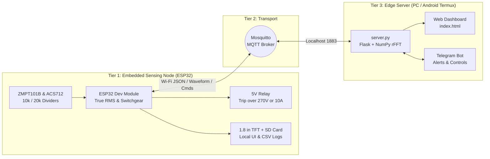
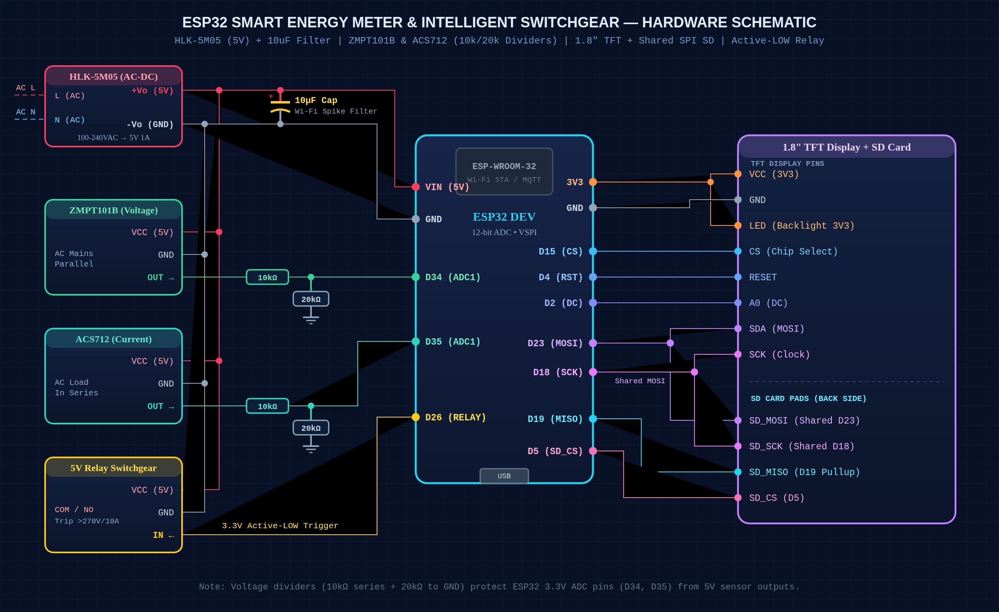

<div align="center">

# ESP32 Smart Energy Meter & Intelligent Switchgear

**IoT-Enabled Digital Energy Metering, Real-Time FFT Harmonic Analysis, and Automated Fault Protection**


[Overview](#overview) • [Architecture](#system-architecture) • [Wiring & Pin Diagram](#step-2-hardware-wiring--pin-diagram) • [ESP32 Setup](#step-3-arduino-ide-setup--flashing-the-esp32) • [Telegram Bot](#step-4-create-a-telegram-bot) • [Server Setup](#step-5-edge-server--mqtt-broker-setup)

</div>

---

## Overview

An **IoT-Enabled Digital Energy Meter and Intelligent Switchgear** built with an **ESP32**, **MQTT**, **Python (Flask + NumPy)**, and a **Telegram Bot**. It measures live electrical parameters, protects loads from over-voltage and over-current faults, logs data locally to an SD card, and offloads heavy **FFT Harmonic Analysis (THD)** and web graphing to an edge server (PC or smartphone).

### Key Capabilities

| Capability | Description |
| :--- | :--- |
| **True RMS Metering** | Measures Voltage (`V`), Current (`A`), Real Power (`W`), Apparent Power (`VA`), Power Factor (`PF`), Energy (`kWh`), and Billing Cost. |
| **Intelligent Switchgear** | Automatically trips the relay if **Voltage > 270 V** or **Current > 10 A**, with a fail-safe lockout and 30-second stabilization auto-clear. |
| **Real-Time FFT & THD** | Coherently samples 100 points at 5 kHz (one exact 50 Hz cycle) and computes Total Harmonic Distortion (3rd & 5th harmonics) in Python. |
| **Dual Data Logging** | Logs locally to a micro-SD card (`datalog.csv`, `hours.csv`, `bill.txt`) on the ESP32 **and** to `campus_power_log.csv` on the edge server. |
| **Live Web Dashboard** | Real-time canvas graphs (`V vs T`, `I vs T`, `V vs I`, `P vs T`, `E vs T`), THD bar chart, flashing fault banner, and remote relay control. |
| **Telegram Bot Control** | Instant fault notifications, live status queries, CSV log downloads, and remote relay/reset inline buttons. |

---

## System Architecture



### Project Structure

```text
ESP32_Energy_Meter/
├── code.cpp             # ESP32 firmware (sensors, TFT, SD, MQTT, relay protection)
├── server.py            # Python edge server (Flask dashboard, MQTT client, FFT, Telegram bot)
├── index.html           # Web dashboard UI served by Flask
├── requirements.txt     # Python dependencies (Flask, paho-mqtt, numpy)
├── pin_diagram.png      # Hardware wiring schematic
└── storage/             # Local storage folder served at /storage/
    └── ofline/          # Offline CSV logs & reports served at /storage/ofline/
```

---

## Step 1: Install Git & Clone This Repository

If you already have Git installed, skip straight to **Clone the Repository**.

<details>
<summary><strong>Click to view Git installation commands (Windows & Linux)</strong></summary>

* **Windows (`winget` in PowerShell / Command Prompt):**
  ```powershell
  winget install --id Git.Git -e --source winget
  ```
  *(Restart your terminal after installing.)*

* **Ubuntu / Debian / Kali / Mint:**
  ```bash
  sudo apt update && sudo apt install -y git
  ```

* **Arch Linux / Manjaro:**
  ```bash
  sudo pacman -S git
  ```

* **Fedora:**
  ```bash
  sudo dnf install -y git
  ```

* **Gentoo:**
  ```bash
  sudo emerge --ask dev-vcs/git
  ```

</details>

### Clone the Repository

```bash
git clone https://github.com/palashhaoladar/ESP32_Energy_Meter.git
cd ESP32_Energy_Meter
```

---

## Step 2: Hardware Wiring & Pin Diagram

> [!CAUTION]
> **MAINS SAFETY WARNING:** The HLK-5M05 input, ZMPT101B primary, ACS712 load path, and Relay `COM`/`NO` terminals carry **lethal 230 V AC mains voltage**. Never touch the circuit while plugged into AC mains, and keep high-voltage wiring strictly isolated from the 5 V / 3.3 V ESP32 side.

<div align="center">
  
  <br/><br/>
  <a href="https://sites.google.com/view/esp32-energy-meter-pin-diagram/full-page-embed">
    
  </a>
</div>

<br/>

### Complete Pin Mapping Reference

| Component | Module Pin | ESP32 / Rail | Notes / Conditioning |
| :--- | :--- | :--- | :--- |
| **HLK-5M05 (AC-DC)** | `+Vo` / `-Vo` | `VIN (5V)` / `GND` | 100–240 V AC to 5 V DC 1 A common rail |
| **10 uF Capacitor** | `+` / `-` | `VIN (5V)` / `GND` | Stabilizes 5 V rail against Wi-Fi TX spikes |
| **ZMPT101B (Voltage)** | `VCC`, `GND`, `OUT` | `5V`, `GND`, **`D34`** | Voltage divider: **10 kOhm** series (`OUT -> D34`) + **20 kOhm** to `GND` |
| **ACS712 (Current)** | `VCC`, `GND`, `OUT` | `5V`, `GND`, **`D35`** | Voltage divider: **10 kOhm** series (`OUT -> D35`) + **20 kOhm** to `GND` |
| **5V Relay Module** | `VCC`, `GND`, `IN` | `5V`, `GND`, **`D26`** | Active-LOW 3.3 V logic trigger |
| **1.8" TFT Display** | `VCC`, `LED`, `GND` | `3V3`, `3V3`, `GND` | Tie `LED` to `3V3` for continuous backlight |
| **1.8" TFT Control** | `CS`, `RESET`, `A0 (DC)` | **`D15`**, **`D4`**, **`D2`** | Dedicated TFT control pins |
| **TFT + SD (Shared SPI)** | `SDA/SD_MOSI`, `SCK/SD_SCK` | **`D23`**, **`D18`** | Shared hardware VSPI bus |
| **SD Card Slot** | `SD_MISO`, `SD_CS` | **`D19`**, **`D5`** | Soldered from back SD pads on TFT module |

---

## Step 3: Arduino IDE Setup & Flashing the ESP32

### 1. Install Arduino IDE
Download and install **Arduino IDE 2.x** from [arduino.cc/en/software](https://www.arduino.cc/en/software) (or on Windows: `winget install ArduinoSA.IDE.stable`).

### 2. Add ESP32 Board Support
1. Open Arduino IDE and navigate to **File -> Preferences**.
2. In **Additional Boards Manager URLs**, paste:
   ```text
   https://espressif.github.io/arduino-esp32/package_esp32_index.json
   ```
3. Click **OK**.
4. Open **Tools -> Board -> Boards Manager**, search for **`esp32`**, and install **esp32 by Espressif Systems**.

### 3. Install Required Libraries
Open **Tools -> Manage Libraries** (Library Manager) and install:
1. **`PubSubClient`** by *Nick O'Leary*
2. **`TFT_eSPI`** by *Bodmer*

> [!IMPORTANT]
> **Configure `TFT_eSPI` Pins:** Open `Arduino/libraries/TFT_eSPI/User_Setup.h`, enable your 1.8" display driver (typically `ST7735_DRIVER`), and verify the pin definitions match:
> `TFT_MOSI 23`, `TFT_SCLK 18`, `TFT_CS 15`, `TFT_DC 2`, `TFT_RST 4`.

### 4. Configure Wi-Fi & MQTT in `code.cpp`
1. Create a new sketch in Arduino IDE, clear the default template, and paste the full contents of **`code.cpp`**.
2. Locate the Wi-Fi & MQTT block near the top:
   ```cpp
   const char* ssid        = "PALASH\xe3\x82\xb7";   // "PALASHシ" (UTF-8)
   const char* password    = "PALASH69";
   const char* mqtt_server = "192.168.43.1";         // IP of your server/phone
   ```
3. Edit `ssid` and `password` to match your Wi-Fi or phone hotspot.

> [!TIP]
> **Lazy Shortcut:** If you're lazy like me, don't even edit the Wi-Fi credentials in `code.cpp`—just set your phone hotspot name to **`PALASHシ`** and password to **`PALASH69`**.

4. Verify `mqtt_server`:
   * **Android phone hotspot:** `192.168.43.1` usually works out of the box.
   * **Windows / Linux PC:** Replace `192.168.43.1` with your PC's local IP address (`ipconfig` on Windows, `ip a` on Linux).

### 5. Flash to ESP32
1. Connect your ESP32 via USB.
2. Select **Tools -> Board -> esp32 -> ESP32 Dev Module**.
3. Select **Tools -> Port** (`COMx` on Windows, `/dev/ttyUSB0` on Linux).
4. Click **Upload**. *(If it stalls on `Connecting...`, hold the **BOOT** button on the ESP32 for 2 seconds.)*

---

## Step 4: Create a Telegram Bot

Configure your Telegram bot **before** starting `server.py` so fault alerts and remote controls work immediately:

1. Open **Telegram** and search for **`@BotFather`** (verified account).
2. Send `/newbot`.
3. Enter a **display name** for your bot (e.g., `Smart Energy Meter`).
4. Enter a **username** ending in `bot` (e.g., `MyEnergyMeter_bot`).
5. Copy the **HTTP API Token** `@BotFather` replies with:
   ```text
   1234567890:ABCdefGHIjklMNOpqrsTUVwxyz123456789
   ```
6. Open **`server.py`** and update lines 22–23:
   ```python
   BOT_TOKEN    = "PASTE_YOUR_HTTP_API_TOKEN_HERE"
   BOT_USERNAME = "MyEnergyMeter_bot"   # Bot username WITHOUT the @
   ```
7. Save `server.py`.

---

## Step 5: Edge Server & MQTT Broker Setup

Expand the guide below for your target platform:

<details>
<summary><strong>Option A: Linux (Ubuntu / Debian / Arch / Fedora)</strong></summary>

1. **Install Python, pip, and Mosquitto:**
   ```bash
   # Ubuntu / Debian
   sudo apt update && sudo apt install -y python3 python3-pip python3-venv mosquitto

   # Arch Linux
   sudo pacman -Syu python python-pip mosquitto

   # Fedora
   sudo dnf install -y python3 python3-pip mosquitto
   ```

2. **Install Python dependencies:**
   ```bash
   cd ESP32_Energy_Meter
   python3 -m venv venv
   source venv/bin/activate
   pip install -r requirements.txt
   ```
   *(On Arch Linux without a venv, you can also run `pip install -r requirements.txt --break-system-packages`.)*

3. **Configure & start Mosquitto:**
   ```bash
   printf "listener 1883 0.0.0.0\nallow_anonymous true\n" > mosquitto.conf
   mosquitto -c mosquitto.conf -d
   ```

4. **Start the server:**
   ```bash
   python3 server.py
   ```

</details>

<details>
<summary><strong>Option B: Windows (PowerShell + winget)</strong></summary>

1. **Install Python and Mosquitto via `winget`:**
   ```powershell
   winget install --id Python.Python.3.12 -e --source winget
   winget install --id EclipseFoundation.Mosquitto -e --source winget
   ```
   *(Restart PowerShell after installation.)*

2. **Install Python dependencies:**
   ```powershell
   cd ESP32_Energy_Meter
   pip install -r requirements.txt
   ```

3. **Windows compatibility tweak in `server.py`:**
   Windows does not support `time.tzset()`. Open `server.py` and comment out line 15:
   ```python
   # time.tzset()
   ```

4. **Configure & start Mosquitto (Terminal 1):**
   ```powershell
   @"
   listener 1883 0.0.0.0
   allow_anonymous true
   "@ | Out-File -Encoding ascii mosquitto.conf

   & "C:\Program Files\mosquitto\mosquitto.exe" -c mosquitto.conf -v
   ```
   *(Allow Private network access if Windows Firewall prompts you so the ESP32 can reach ports `1883` and `5000`.)*

5. **Start the server (Terminal 2):**
   ```powershell
   cd ESP32_Energy_Meter
   python server.py
   ```

</details>

<details>
<summary><strong>Option C: Android (Termux — Zero-PC Portable Edge Server)</strong></summary>

Running the server directly on your Android phone with its Mobile Hotspot enabled eliminates the need for any external PC or cloud server.

1. **Install Termux** from [F-Droid](https://f-droid.org/en/packages/com.termux/) *(avoid the outdated Google Play Store build)*.
2. **Install packages:**
   ```bash
   pkg update && pkg upgrade -y
   pkg install -y git python python-numpy mosquitto
   ```
   *(Installing `python-numpy` via `pkg` avoids slow compilation on Android.)*

3. **Clone & install Python packages:**
   ```bash
   git clone https://github.com/palashhaoladar/ESP32_Energy_Meter.git
   cd ESP32_Energy_Meter
   pip install flask paho-mqtt
   ```

4. **Add your Telegram credentials to `server.py`:**
   ```bash
   nano server.py
   ```
   *(Press `Ctrl + O`, `Enter` to save, then `Ctrl + X` to exit.)*

5. **Turn ON your Android Mobile Hotspot** (matching the SSID & password in `code.cpp`).

6. **Configure & launch Mosquitto + Flask:**
   ```bash
   printf "listener 1883 0.0.0.0\nallow_anonymous true\n" > mosquitto.conf
   mosquitto -c mosquitto.conf -d
   python server.py
   ```

</details>

---

## Step 6: Launch Dashboard & Activate Bot

### 1. Access the Web Console
Power on your ESP32 and wait for the TFT to display `Connected!`. Then open a browser on the same network:

| Setup Type | Dashboard URL |
| :--- | :--- |
| **Android Hotspot (Termux)** | `http://192.168.43.1:5000` |
| **Local PC (Same Machine)** | `http://localhost:5000` |
| **Other Device on Same Wi-Fi** | `http://<SERVER_IP>:5000` |

### 2. Telegram Bot Commands
Open your bot in Telegram and send **`/start`** to subscribe to fault alerts and open the inline button menu:

| Command | Action |
| :--- | :--- |
| `/start` | Subscribe to fault alerts and display the interactive button panel |
| `/status` | Fetch live Voltage, Current, Power, PF, Energy, Relay, and Fault state |
| `/csv` | Download `campus_power_log.csv` directly in Telegram |
| `/relay` | Toggle the ESP32 switchgear relay ON/OFF |
| `/reset` | Reset energy counters and clear any active fault latch |
| `/unsubscribe` | Stop receiving automated fault alerts |

---

## Troubleshooting

| Symptom | Likely Cause & Fix |
| :--- | :--- |
| **ESP32 stuck on `MQTT retry...`** | Verify Mosquitto is running with `listener 1883 0.0.0.0` and `allow_anonymous true`, and confirm `mqtt_server` in `code.cpp` matches your server IP. |
| **TFT shows a blank white screen** | Double-check `User_Setup.h` in `TFT_eSPI` (`ST7735_DRIVER` and pins `CS=15`, `RST=4`, `DC=2`, `MOSI=23`, `SCLK=18`). |
| **TFT shows `NO` for SD card** | Use a FAT32-formatted micro-SD card (`<= 32 GB`) and verify the `D5` (`SD_CS`) and `D19` (`SD_MISO`) solder joints. |
| **Telegram bot does not respond** | Confirm the device running `server.py` has internet access and that `BOT_TOKEN` / `BOT_USERNAME` have no trailing spaces. |